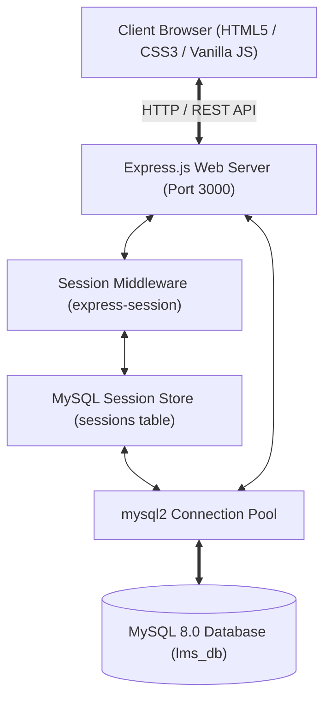
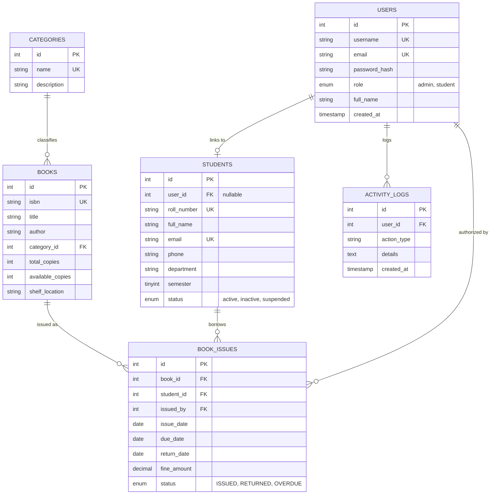

# Library Management System (LMS)
**B.Tech Web Development Minor Project**

A modern, responsive, full-stack academic Library Management System built with **Node.js**, **Express.js**, **MySQL 8.0**, and **Vanilla JavaScript** (HTML5 & CSS3).

---

## 📚 Table of Contents

- [Project Overview](#-project-overview)
- [Key Features](#-key-features)
- [Technology Stack](#-technology-stack)
- [System Architecture](#-system-architecture)
- [Database Design & ER Diagram](#-database-design--er-diagram)
- [Project Directory Structure](#-project-directory-structure)
- [Prerequisites & Installation](#-prerequisites--installation)
- [Database Setup & Verification](#-database-setup--verification)
- [Default Login Credentials](#-default-login-credentials)
- [Security & Architecture Highlights](#-security--architecture-highlights)
- [Minor Project Academic Viva Q&A](#-minor-project-academic-viva-qa)

---

## 🎯 Project Overview

The **Library Management System (LMS)** automates and streamlines traditional library workflows:
- Secure role-based authentication (Librarian/Admin vs. Student).
- Comprehensive catalog tracking with live availability counts and physical rack locations.
- Student record keeping with semester and department tagging.
- Automated book issue and return transactions with overdue fine computation.
- Real-time audit logs and statistical dashboards.

---

## 🌟 Key Features

1. **Authentication & RBAC:**
   - Admin and Student portal logins.
   - Passwords hashed using industry-standard `bcryptjs` (salt rounds: 10).
   - MySQL-backed persistent sessions via `express-mysql-session`.

2. **Dashboard & Analytics:**
   - 5 core metric cards: Total Books, Total Students, Available Books, Issued Books, Overdue Books.
   - Real-time recent transaction activity feed.

3. **Book Management:**
   - Add, edit, remove, and search books by ISBN, title, author, or category.
   - Dynamic tracking of total vs. available copies.

4. **Student Management:**
   - Student registration with unique roll numbers, departments, and semesters.
   - Searchable student directory and personal borrowing histories.

5. **Issue & Return Desk:**
   - Issue books with automatic stock decrement.
   - Return processing with automatic stock restoration and late fine calculation (₹5/day default).
   - Atomic database transactions (`START TRANSACTION`, `COMMIT`, `ROLLBACK`) preventing inventory corruption.

6. **Reports Module:**
   - Categorized reports: Book stock, student directories, active borrowings, and overdue reports.

---

## 🛠️ Technology Stack

| Layer | Technology | Details |
| :--- | :--- | :--- |
| **Frontend** | HTML5, CSS3, JavaScript | Pure Vanilla JS, responsive design, Oxford Navy Blue palette |
| **Backend** | Node.js (v24+) & Express.js | RESTful JSON API, session middleware |
| **Database** | MySQL Server 8.0 | Standalone server on port 3306 |
| **DB Driver** | `mysql2/promise` | Connection pooling, prepared statements, async/await |
| **Session Store**| `express-mysql-session` | Persistent server-side sessions in MySQL `sessions` table |
| **Security** | `bcryptjs` | Irreversible password hashing |

---

## 📐 System Architecture



---

## 🗄️ Database Design & ER Diagram

The database name is strictly isolated as **`lms_db`** to protect any existing databases on your MySQL server.

### Relational Tables:
1. **`users`**: Administrative and student user credentials, password hashes, and roles.
2. **`students`**: Academic profile information (roll number, email, phone, department, semester, status).
3. **`categories`**: Book classifications (Computer Science, Electronics, Mechanical, Mathematics, etc.).
4. **`books`**: Book records (ISBN, title, author, publisher, total copies, available copies, shelf rack).
5. **`book_issues`**: Lending transactions, issue dates, due dates, return dates, and late fines.
6. **`activity_logs`**: System audit trail capturing book additions, issues, and returns.
7. **`sessions`**: Server-side user login sessions.

### Entity Relationship Diagram:



---

## 📁 Project Directory Structure

```
C:\Library_Management_System\
│
├── database\
│   ├── schema.sql                 # DDL: Creates lms_db, 6 relational tables + sessions
│   ├── seed.sql                   # DML: High-quality academic sample data with hashed passwords
│   └── initDb.js                  # Automated runner: node database/initDb.js
│
├── public\                        # Static Web Assets (Frontend)
│   ├── css\
│   │   ├── variables.css          # Navy blue palette & design tokens
│   │   ├── base.css               # Resets and typography
│   │   ├── components.css         # Buttons, cards, modals, tables, badges
│   │   ├── dashboard.css          # Metric counters and charts
│   │   └── responsive.css         # Breakpoint rules
│   ├── js\
│   │   ├── api.js                 # Central Fetch API service
│   │   ├── auth.js                # Login, logout, session logic
│   │   ├── books.js               # Book catalog controller
│   │   ├── students.js            # Student directory controller
│   │   ├── issue-return.js        # Circulation desk controller
│   │   ├── reports.js             # Reports and filters
│   │   └── utils.js               # Toast notifications & date helpers
│   ├── pages\
│   │   ├── admin-dashboard.html   # Admin master panel
│   │   ├── student-dashboard.html # Student self-service panel
│   │   ├── books.html             # Book catalog management
│   │   ├── students.html          # Student directory
│   │   ├── issue-return.html      # Lending & returns desk
│   │   └── reports.html           # System reports
│   └── index.html                 # Unified portal entry & login screen
│
├── src\                           # Backend Source Code (Express & Node.js)
│   ├── config\
│   │   ├── db.js                  # MySQL2 connection pool, error handling, transaction helper
│   │   └── testConnection.js      # Comprehensive DB verification script
│   ├── controllers\               # Business logic handlers (Phase 2 & 3)
│   ├── middleware\                # Auth, RBAC & error handlers (Phase 2)
│   ├── routes\                    # REST API endpoints (Phase 2 & 3)
│   └── server.js                  # Express app entry point
│
├── .env.example                   # Template for environment configuration
├── .env                           # Local environment configuration (DB credentials)
├── .gitignore                     # Git ignore rules for node_modules, .env, and logs
├── package.json                   # Project metadata, dependencies, and npm scripts
└── README.md                      # Project documentation and viva guide
```

---

## ⚡ Prerequisites & Installation

### 1. Prerequisites
- **Node.js**: v18.0.0 or higher (Installed: `v24.21.0`)
- **MySQL Server 8.0**: Standalone server installed and running on port 3306.

### 2. Configure Environment (`.env`)
Edit the `.env` file in the project root directory and enter your MySQL root password:

```env
PORT=3000
NODE_ENV=development

# Session Encryption Key
SESSION_SECRET=lms_super_secret_session_key_academic_minor_project_2026

# MySQL 8.0 Database Configuration
DB_HOST=localhost
DB_PORT=3306
DB_USER=root
DB_PASSWORD=your_actual_mysql_root_password
DB_NAME=lms_db
DB_CONNECTION_LIMIT=10

# Academic Library Business Rules
LOAN_PERIOD_DAYS=14
FINE_RATE_PER_DAY=5.00
MAX_BOOKS_PER_STUDENT=3
```

---

## 🚀 Database Setup & Verification

Execute the built-in npm commands to initialize and verify the database:

### Step 1: Initialize Database & Seed Data
```powershell
npm run db:init
```
*What this does:* Connects to MySQL, safely executes `database/schema.sql` (creating `lms_db` and all tables), and executes `database/seed.sql` to populate sample academic records.

### Step 2: Verify Database Health & Foreign Keys
```powershell
npm run db:test
```
*What this does:* Tests pool connectivity, verifies the existence of all 6 relational tables, and validates foreign key integrity.

---

## 🔑 Default Login Credentials

All passwords in `database/seed.sql` are securely hashed using `bcryptjs`:

| Role | Username | Password | Full Name / Description |
| :--- | :--- | :--- | :--- |
| **Admin / Librarian** | `admin` | `Admin@123` | Chief Librarian Dr. Sharma |
| **Student** | `rahul101` | `Student@123` | Rahul Kumar (Roll: `22CS101`, CSE Dept) |
| **Student** | `priya104` | `Student@123` | Priya Sharma (Roll: `22EC104`, ECE Dept) |
| **Student** | `aman112` | `Student@123` | Aman Singh (Roll: `23IT112`, IT Dept) |

---

## 🛡️ Security & Architecture Highlights

1. **Zero Plaintext Passwords:**
   All user passwords undergo 10 rounds of salt generation and hashing via `bcryptjs`.
2. **Prepared Statements / Parameterized Queries:**
   All SQL statements use `mysql2/promise` placeholders (`?`), preventing SQL Injection attacks.
3. **Database Transactions:**
   Book issuing and returns utilize atomic transactions (`withTransaction` helper in `src/config/db.js`), guaranteeing that stock counts and issue records update simultaneously or roll back together.
4. **Referential Integrity:**
   `FOREIGN KEY ... ON DELETE RESTRICT` protects against accidental deletion of books or students with active borrowings.
5. **Session Store in MySQL:**
   Sessions persist safely in the MySQL `sessions` table, preventing user logouts when the server restarts.

---

## 🎓 Minor Project Academic Viva Q&A

**Q1: Why did you choose MySQL over MongoDB for this project?**  
> *Answer:* A Library Management System is inherently relational with strict constraints between books, students, and loan transactions. MySQL provides ACID compliance, foreign key referential integrity, and atomic transactions, ensuring that available stock counts and transaction records never go out of sync.

**Q2: What is the purpose of connection pooling in `mysql2`?**  
> *Answer:* Creating and destroying a TCP connection to MySQL for every HTTP request introduces significant latency. A connection pool maintains an active set of reusable connections, reducing server overhead and enabling concurrent request processing.

**Q3: How does the system prevent race conditions when two students try to borrow the last available copy of a book?**  
> *Answer:* The checkout process is wrapped inside an atomic MySQL transaction (`withTransaction`) with row-level locking (`SELECT ... FOR UPDATE` or conditional `UPDATE books SET available_copies = available_copies - 1 WHERE id = ? AND available_copies > 0`). If stock is zero, the transaction rolls back cleanly.

**Q4: How are passwords protected?**  
> *Answer:* Passwords are never stored in plaintext. They are salted and hashed using `bcryptjs`. During authentication, `bcrypt.compare()` compares the plain password attempt against the cryptographic hash in constant time, preventing timing attacks.
